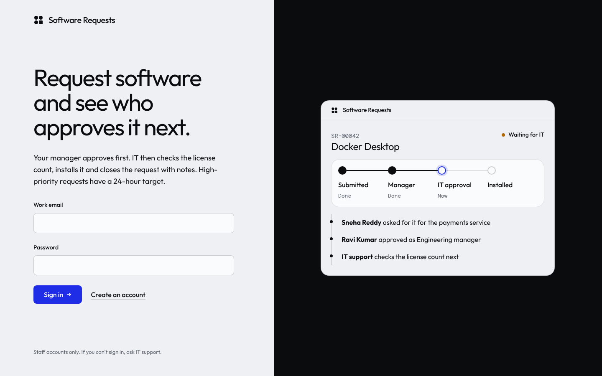
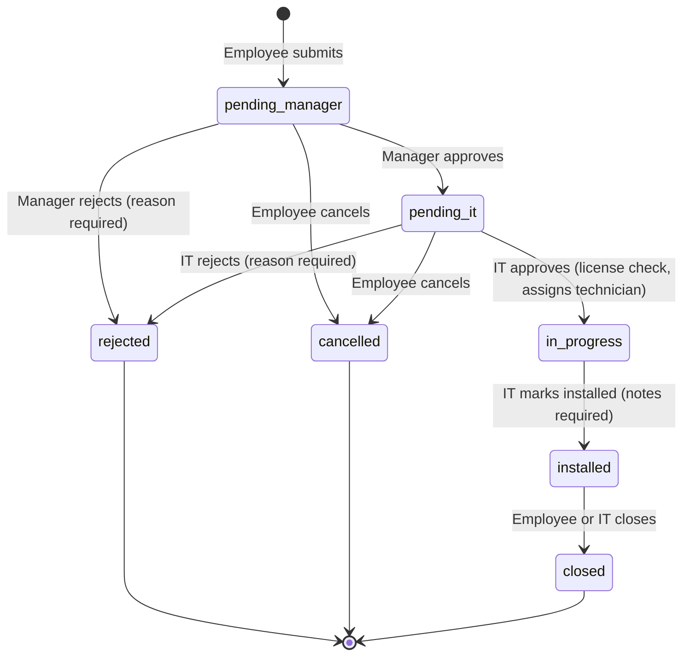
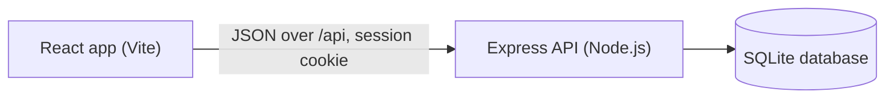
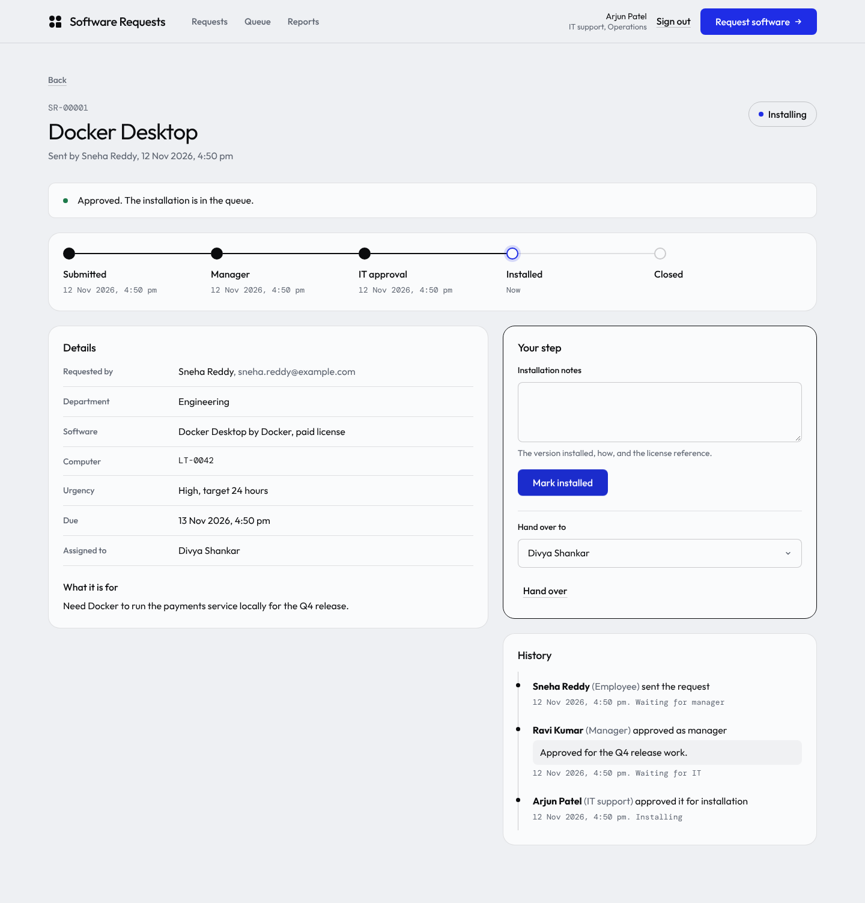

# Software Installation Request System

A web application where employees request software for their work computers, managers approve or reject the request, and IT support checks licensing, installs the software, and closes the ticket. Every step is stored in a database with who did it and when, and the reports page calculates approval times and SLA compliance from those timestamps.



## The problem

In many offices, software requests go by email or chat. Approvals get lost, nobody knows who is supposed to act next, IT installs paid software without checking whether licenses are left, and there is no record of how long requests take.

## What this application does

- Employees create an account, pick software from a catalog, and track each request through its stages.
- Managers only see requests from their own department and must give a reason when rejecting.
- IT support approves for installation (checking license availability), assigns a technician, records installation notes, and marks the work done.
- Admins manage users, roles, departments and the software catalog, and can see every request, the reports and an audit log.

## Workflow



Rules enforced by the server (`server/workflow.js`):

| Rule | How it is enforced |
|---|---|
| Only valid transitions | Each action lists the statuses it can start from. Anything else returns `409`. |
| One open request per person per software | Checked before insert, and backed by a partial unique index in the database. |
| Licensed software needs a proper reason | At least 30 characters of justification. |
| No license, no installation | IT approval is refused when the licenses in use reach the license count. |
| Rejection needs a reason | Both rejection actions require a note. |
| Nobody approves their own request | Checked for manager and IT approval. |
| Managers only act on their department | The request's department must match the manager's. |
| Two people acting at once | The update only applies if the status is still what was read, inside a transaction. |

## Roles

| | Employee | Manager | IT support | Admin |
|---|:-:|:-:|:-:|:-:|
| Submit and track own requests | ✓ | ✓ | ✓ | ✓ |
| Cancel own pending request | ✓ | ✓ | ✓ | ✓ |
| Approve/reject for own department | | ✓ | | ✓ (any department) |
| Install queue, IT approval, assign, mark installed | | | ✓ | ✓ |
| Reports | | Own department | Requests that reached IT | All |
| Users, catalog, all requests, audit log | | | | ✓ |

New accounts are always employees. Only an admin can change a role.

## Architecture



- **Frontend:** React 18 with React Router, built with Vite. Plain CSS in one file (`client/src/styles.css`), no UI framework. Fonts (Outfit and DM Mono) are bundled with the app, not loaded from Google.
- **Backend:** Node.js with Express. Input is validated with Zod. Passwords are hashed with bcrypt. Sessions are signed JWTs stored in an httpOnly cookie.
- **Database:** SQLite through `better-sqlite3`. The schema is in `server/schema.sql`.
- In production, the Express server also serves the built React files, so the whole application runs as one service.

### Why these choices

- **One server and one database file.** There are no external services to configure, so anyone can clone the project and run it in a couple of minutes. The SQL is standard and could be moved to PostgreSQL later.
- **Roles are read from the database on every request.** The browser never sends its own role. Changing someone's role or deactivating them takes effect immediately.
- **Cookie instead of localStorage for the session.** JavaScript on the page cannot read an httpOnly cookie, which limits the damage from any XSS bug.

## Design

The interface follows [Taste Skill](https://github.com/Leonxlnx/taste-skill) 2.5 (MIT licence), a set of frontend design rules. Its dealer scripts picked the palette, typefaces and component styles for a software product:

- **Palette:** cool grey with one cobalt accent, used only for the main button, links and focus. The interface stays almost entirely neutral. Status is shown with small coloured dots, not coloured boxes. (The dealer's first palette, teal, was skipped because it was too close to the previous design.)
- **Type:** Outfit for text and headings, DM Mono for request numbers and timestamps.
- **Components:** the skill's 4/8px spacing scale, 44px buttons, 48px form fields with labels above and errors under each field, and a 2px focus ring.
- **Navigation:** a fixed top bar with plain one-word links, and a drop-down panel for the admin pages. On phones it becomes a full-screen menu.
- **Motion:** buttons step up 1px on hover and press down on click, links draw an underline, and the queue tabs slide. The sign-in headline rises line by line once per visit. Nothing moves on scroll, and everything stays still with reduced motion turned on.

The skill is written for marketing websites. Its rules about photographs, section heights and footers were not used, because these are work screens, not a website.



## Folder structure

```
.
├── server/
│   ├── index.js          Starts the server (and seeds an empty database if SEED_PASSWORD is set)
│   ├── app.js            Express app: security middleware, routes, static files
│   ├── config.js         Reads environment variables
│   ├── db.js             Opens SQLite and applies schema.sql
│   ├── schema.sql        Tables, constraints and indexes
│   ├── auth.js           Session cookie, requireAuth, requireRole
│   ├── workflow.js       Status rules, permissions, visibility, license check
│   ├── errors.js         Error type, Zod validation helper, error handler
│   ├── seedData.js       Departments, starter accounts and software catalog
│   ├── seed.js           `npm run seed`
│   └── routes/           auth, requests, software, admin, stats
├── client/
│   ├── index.html
│   ├── vite.config.js    Dev server, forwards /api to port 4000
│   └── src/
│       ├── App.jsx       Routes and role checks
│       ├── auth.jsx      Signed-in user state
│       ├── api.js        fetch wrapper
│       ├── components/   Layout, tables, status labels, stage track
│       └── pages/        One file per screen
├── tests/api.test.js     Automated API tests
├── docs/screenshots/
└── .env.example
```

## Database

| Table | Purpose |
|---|---|
| `departments` | Engineering, Finance, Marketing, Operations (editable in seed data) |
| `users` | Name, email (unique), bcrypt password hash, role, department, active flag |
| `software` | Catalog entries, whether a paid license is needed, how many licenses are owned |
| `requests` | One row per request: status, who decided each step and when, assignee, notes, rejection reason |
| `request_events` | History of every action on a request: who, what, status before and after, note |
| `sla_targets` | Hours allowed from submission to installation per urgency (high 24, normal 72, low 120) |
| `audit_log` | Account and catalog changes made by admins, and new registrations |

Foreign keys are switched on, statuses and roles are limited with `CHECK` constraints, and the tables have indexes for the common lookups (by user, status, department and software).

## Running it locally

Requirements: Node.js 20 or 22 (LTS).

```bash
git clone https://github.com/RishanthDeveloper/Software-Installation-Request-Automation.git
cd Software-Installation-Request-Automation

npm install              # installs server and client dependencies
cp .env.example .env     # then edit .env: set JWT_SECRET and SEED_PASSWORD
npm run seed             # creates data/app.db with departments, software and starter accounts
```

Start the API and the frontend in two terminals:

```bash
npm run dev:server       # API on http://localhost:4000
npm run dev:client       # app on http://localhost:5173
```

Or build and run it the way it runs in production:

```bash
npm run build
npm start                # app and API on http://localhost:4000
```

### Starter accounts

All use the password you set as `SEED_PASSWORD`.

| Email | Role | Department |
|---|---|---|
| admin@example.com | Admin | Operations |
| ravi.kumar@example.com | Manager | Engineering |
| meera.nair@example.com | Manager | Finance |
| arjun.patel@example.com | IT support | Operations |
| divya.shankar@example.com | IT support | Operations |
| sneha.reddy@example.com | Employee | Engineering |
| karan.mehta@example.com | Employee | Finance |

### Environment variables

| Name | Required | Description |
|---|---|---|
| `JWT_SECRET` | In production | Secret used to sign session cookies. Use a long random string. |
| `SEED_PASSWORD` | For seeding | Password for the starter accounts. |
| `DATABASE_PATH` | No | SQLite file location. Default `data/app.db`. |
| `PORT` | No | Default `4000`. |
| `NODE_ENV` | No | Set to `production` when deployed (enables secure cookies). |
| `AUTH_RATE_LIMIT` | No | Login/registration attempts per IP per 15 minutes. Default 20. |

## Demo walkthrough

1. Sign in as **sneha.reddy@example.com**, choose *Request software*, pick Docker Desktop, fill in the form and submit. Try submitting the same software again: it is refused.
2. Sign out and sign in as **ravi.kumar@example.com** (Engineering manager). The request is in *Approvals*. Open it and approve it.
3. Sign in as **arjun.patel@example.com** (IT support). The request is in *Install queue*. Approve it and assign a technician, then add installation notes and mark it installed.
4. Sign in as Sneha again and close the request. The stage track and history show every step with times.
5. Sign in as **admin@example.com** to see *Reports*, change a user's role in *Users*, edit license counts in *Software catalog*, and review the *Audit log*.

## API

All endpoints are under `/api`. Request and response bodies are JSON. Errors look like `{ "error": "message" }`.

| Method | Path | Who | Description |
|---|---|---|---|
| GET | `/departments` | Anyone | List departments (for registration) |
| POST | `/auth/register` | Anyone | Create an employee account and sign in |
| POST | `/auth/login` | Anyone | Sign in |
| POST | `/auth/logout` | Anyone | Sign out |
| GET | `/auth/me` | Signed in | Current user |
| GET | `/software` | Signed in | Active catalog with licenses in use (`?all=1` for admins includes hidden) |
| POST | `/software` | Admin | Add software |
| PATCH | `/software/:id` | Admin | Edit software, license count, hide/show |
| GET | `/requests` | Signed in | List requests the user may see. `view=mine\|approvals\|queue\|all`, `status`, `q` |
| POST | `/requests` | Signed in | Submit a request |
| GET | `/requests/:id` | Signed in | Request detail, history, and the actions this user may take |
| POST | `/requests/:id/actions` | Depends on action | `{ action, note?, assigneeId? }`. Actions: `cancel`, `manager_approve`, `manager_reject`, `it_approve`, `it_reject`, `assign`, `mark_installed`, `close` |
| GET | `/stats` | Manager, IT, admin | Counts, average times, SLA compliance, top software |
| GET | `/admin/users` | Admin | List users |
| PATCH | `/admin/users/:id` | Admin | Change role, department, active flag |
| GET | `/admin/technicians` | IT, admin | People who can be assigned installs |
| GET | `/admin/audit` | Admin | Audit log |

Requests a user is not allowed to see return `404` rather than `403`, so the API does not reveal whether a request number exists.

## Security

- Passwords hashed with bcrypt (cost 10). A failed login takes the same time whether or not the email exists.
- Session in an httpOnly, SameSite=Lax cookie (Secure in production), valid for 8 hours.
- The user and role are loaded from the database on every request.
- Every query uses parameters, never string-built values from user input.
- All input is validated with Zod, with length limits.
- React escapes everything it renders, and there is no `dangerouslySetInnerHTML`.
- Helmet sets security headers including a Content Security Policy.
- Write requests must be JSON, which, together with SameSite cookies, blocks cross-site form posts.
- Login and registration are rate limited.
- No secrets are in the code. `.env` is ignored by git.

## Tests

```bash
npm test
```

There are 17 API tests (Node's built-in test runner, in-memory database). They cover:

- registration, including an attempt to sign up as admin;
- wrong passwords and forged cookies;
- the full approve, install and close path;
- duplicate prevention;
- manager and IT rejection;
- the licensed-software justification and license limits;
- cancellation;
- who can see which requests, and role-restricted endpoints;
- role changes applying immediately, and deactivation;
- stats matching the database;
- non-JSON writes being refused;
- data persisting in a database file.

The screenshots in `docs/screenshots` were taken during an automated browser run of the walkthrough above, at desktop, tablet and phone sizes. That run also checked field errors, the duplicate warning, the admin menu, the queue tabs, the phone menu, and that no page scrolls sideways at 390px.

## Deployment

The app needs a host that runs a Node.js server and keeps a file between restarts (for the SQLite database). Render, Railway or any VPS works. Example for **Render**:

1. Create a new *Web Service* from this repository.
2. Build command: `npm install && npm run build`. Start command: `npm start`.
3. Add a persistent disk mounted at `/var/data`.
4. Set environment variables:
   - `NODE_ENV=production`
   - `JWT_SECRET` (a long random string)
   - `DATABASE_PATH=/var/data/app.db`
   - `SEED_PASSWORD` (the starter accounts are created on the first start)

Without a persistent disk, the database is wiped each time the service restarts. Serverless platforms such as Vercel are not suitable for this version because they have no writable disk; that would need a hosted database (see below).

## Known limitations

- There are no email notifications. People see changes when they open the app.
- SLA hours are calendar hours, not working hours, and there is no pause while waiting on the employee.
- Licenses are counted from requests. Uninstalling software and returning a license is not tracked.
- There is no password reset flow. An admin cannot set passwords from the UI.
- The schema is applied from one file with `CREATE ... IF NOT EXISTS`. Changing an existing column would need a proper migration step.
- SQLite suits one server instance. Running several instances would need PostgreSQL (for example Supabase).
- Department and SLA target lists are edited in the seed data or the database, not in the UI.
